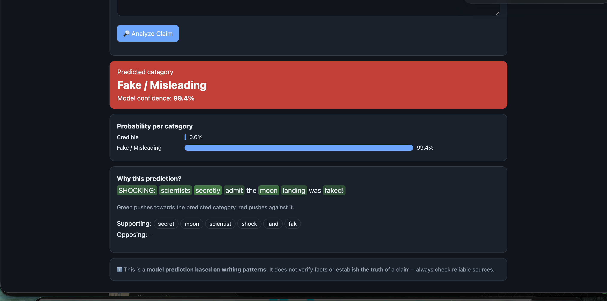

# 🔍 VeriScope – Fake News & Claim Classification

**NLP Capstone · Group 6 · Project 6: Fake News or Claim Classification**

VeriScope takes a news headline or claim and predicts its **credibility category** using a model trained on the
[LIAR dataset](https://www.cs.ucsb.edu/~william/data/liar_dataset.zip) (≈12.8k statements fact-checked by PolitiFact).
It runs in two modes:

| Mode | Output |
|---|---|
| **6 categories** | Pants on Fire · False · Barely True · Half True · Mostly True · True |
| **Binary** | Fake / Misleading vs Credible / Mostly True |

> ⚠️ The app presents a **model prediction based on writing patterns**. It does **not** verify facts or establish absolute truth.

---

## ✨ Features
- Full from-scratch pipeline: collection → cleaning → preprocessing → EDA → feature engineering → modelling → evaluation → GUI
- 3 feature sets (BoW, TF-IDF unigram, TF-IDF 1-2 gram) × 5 models (Multinomial NB, Complement NB, Logistic Regression, Linear SVM, Random Forest) compared automatically
- Model selected on **validation** macro-F1, reported on an **untouched test set** (no leakage; duplicate claims removed)
- Streamlit GUI: confidence score, probability chart, **word-level explanation** (highlighted claim), session history + CSV download, performance & EDA dashboards

## 📁 Project structure
```
VeriScope/
├── app.py                  # Streamlit GUI
├── run_pipeline.py         # one command: data → EDA → train
├── config.py               # paths, labels, constants
├── requirements.txt
├── src/
│   ├── download_data.py    # fetch LIAR
│   ├── prepare_data.py     # cleaning + preprocessing → data/processed
│   ├── preprocess.py       # tokenisation, stop-words, stemming
│   ├── eda.py              # charts → reports/figures
│   ├── features.py         # BoW / TF-IDF vectorizers
│   ├── train.py            # model training, comparison, evaluation
│   ├── predict.py          # inference + word-level explanation
│   └── make_demo_data.py   # SYNTHETIC data for dry-runs only
├── notebooks/VeriScope_Walkthrough.ipynb
├── data/ (raw, processed)  models/  reports/  screenshots/  docs/
```

## 🌐 No-install web version
`web_app/VeriScope.html` is a single-file version of the whole pipeline that runs in any browser (double-click to open). Use the *Data & Training* tab to upload LIAR `train.tsv` / `valid.tsv` / `test.tsv` and train in seconds. It starts with a tiny built-in sample, so train on LIAR for real results.

## 🚀 Setup & run
```bash
python -m venv .venv
source .venv/bin/activate          # Windows: .venv\Scripts\activate
pip install -r requirements.txt

python run_pipeline.py             # downloads LIAR, cleans, EDA, trains (takes a few minutes)
streamlit run app.py               # opens the GUI at http://localhost:8501
```
No internet? Place `train.tsv`, `valid.tsv`, `test.tsv` from the LIAR zip into `data/raw/` and re-run `python run_pipeline.py`.
Quick code check without real data: `python run_pipeline.py --demo` (synthetic data – the GUI shows a warning banner).

Individual steps: `python -m src.prepare_data` · `python -m src.eda` · `python -m src.train` · `python -m src.predict "your claim"`

## 🧠 Methodology
1. **Dataset** – LIAR train/valid/test (10.2k / 1.3k / 1.3k) with 6 labels; binary view = {pants-fire, false, barely-true} vs {half-true, mostly-true, true}.
2. **Cleaning** – drop rows with missing claim/label, invalid labels, duplicate claims (train copy kept), fill missing metadata.
3. **Preprocessing** – lower-case, strip URLs/HTML/symbols, numbers → `num`, `n't` → `not`, regex tokenisation, stop-word removal (**negations kept**), Porter stemming.
4. **Features** – Bag-of-Words, TF-IDF (unigram), TF-IDF (unigram+bigram, sublinear tf).
5. **Models** – Naive Bayes (2 variants), Logistic Regression, Linear SVM (probability-calibrated), Random Forest; class-balanced where supported.
6. **Evaluation** – Accuracy, Precision, Recall, F1 (macro & weighted), confusion matrix, per-class report, majority-class baseline.
7. **Explainability** – linear-model coefficients × TF-IDF value give each word's push towards/against the predicted class.

## 📊 Results
Fill in after running (`reports/*_model_comparison.csv`, `models/*_metrics.json`, or the *Model Performance* tab):

| Mode | Best model | Accuracy | Precision | Recall | F1 (macro) |
|---|---|---|---|---|---|
| Binary | _ | _ | _ | _ | _ |
| 6-class | _ | _ | _ | _ | _ |

**How to read the numbers:** LIAR is a hard benchmark. Text-only 6-class models in the literature reach only about 25–28 % accuracy (random = 16.7 %); binary results around the low 60s are typical. The goal here is a sound, reproducible pipeline and an honest comparison – not inflated scores.

## ⚠️ Limitations
- Learns style/topic cues, **not facts**; cannot fact-check.
- US political statements (2007–2016) – may not transfer to other domains/periods.
- Neighbouring classes (Half True vs Mostly True) are very hard to separate from text alone.

## 🔭 Future scope
Transformer models (BERT/RoBERTa) · speaker/context metadata · evidence retrieval from trusted sources · multilingual support.

## 🖼️ Screenshots


_Screenshot of the web version on the built-in sample model. Replace it with one taken after training on LIAR._

## 👥 Team
Group 6 – _add names & roll numbers_

## 📚 Reference
Wang, W. Y. (2017). *“Liar, Liar Pants on Fire”: A New Benchmark Dataset for Fake News Detection.* ACL.
